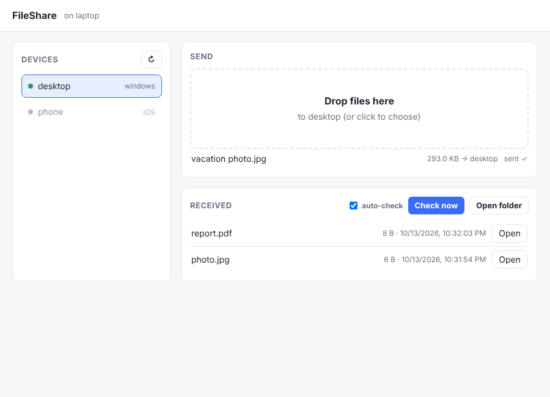

FileShare is a small desktop app for moving files between the devices on your
[Tailscale](https://tailscale.com) network. The same window checks for files other
devices send you and saves them to `~/Downloads/FileShare`.

It is built on Taildrop, Tailscale's own file sending, so there is nothing to set up
on the other side: any device running Tailscale can receive, including phones.

{fig-align="center" width="560"}

## Why FileShare

- **One file, no installs.** A single Python script using only the standard library.
- **Works on Windows, macOS and Linux.** Opens in its own window when Chrome, Edge or Chromium is installed, otherwise in a browser tab.
- **Receives automatically.** Every 5 seconds it collects anything waiting for you.
- **Stays on your machine.** The window talks to a tiny server on `127.0.0.1`, protected by a random per-launch token.

[Install FileShare](install.qmd){.btn .btn-primary}
[View on GitHub](https://github.com/GabeAlencar/fileshare){.btn .btn-outline-secondary}
